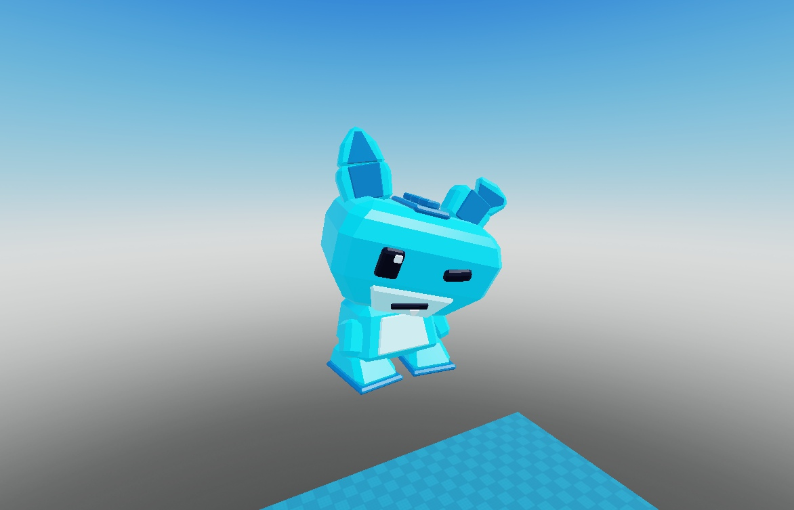

# Referências visuais

Imagens locais do cofre para consulta rápida sem depender de pastas temporárias. Regras completas em [[01_Produto/Design UI UX]] e análise em [[06_Referencias/Estudo visual Steal an Egg]].

As quatro novas referências de cenário enviadas em 28/10/2026 estão junto de sua leitura e receita em [[01_Produto/Receita de Ilhas e Cenarios]].

## 1. Evolução do Lumito no projeto

### Modelo atual integrado — Lumito base v01 (`ee6e901`)

Modelo facetado de brinquedo criado no Blender (`Art/Lumito/Lumito_Base_v01.blend`) e integrado no Studio (`ReplicatedStorage.HACLumitoTemplate` e `HACCreaturePreviews`). Aguarda avaliação em playtest humano.

### Protótipo anterior substituído (histórico)

Registro do protótipo inicial (esfera com peças soltas), mantido apenas como comparação histórica do que foi substituído.

## 2. Referências externas de UI e botões (não são capturas do nosso jogo)

### Botões glossy e HUD

Referência de volume glossy, contorno escuro, ícones próprios e números fortes (`Fredoka One`). Não copiar botões sem função no nosso escopo.

### Index, Shop e Settings

Aproveitar hierarquia visual, grade de cartões, silhuetas de não-descobertos, destaque de preço e botão `X` evidente. Não importar mecânicas ausentes do nosso escopo (como recompensas de `Claim` no Index, ovos, compras em Robux ou timers de urgência artificial).
