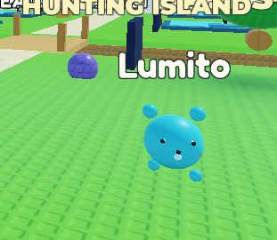
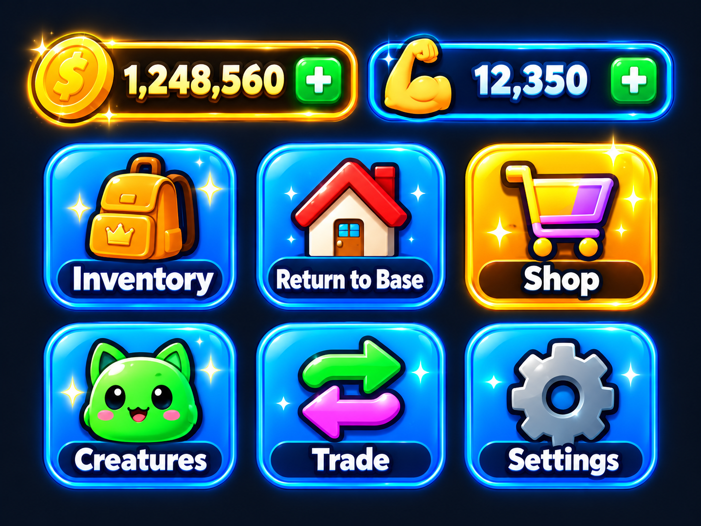
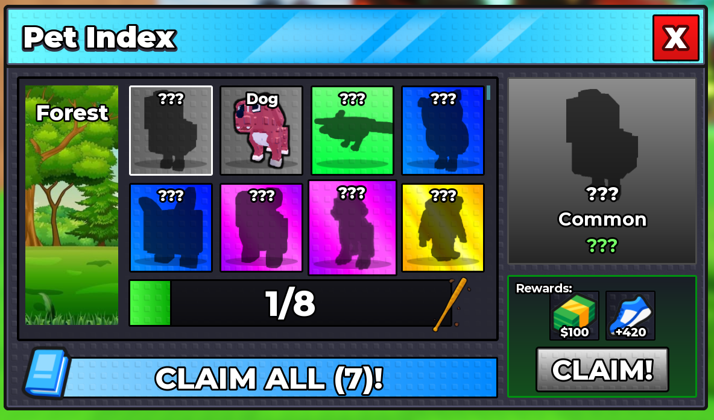
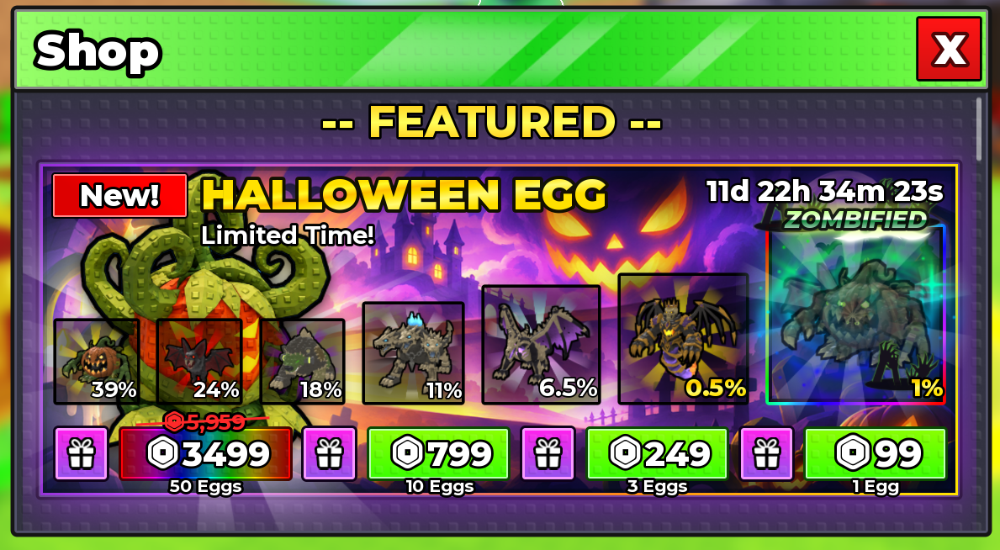
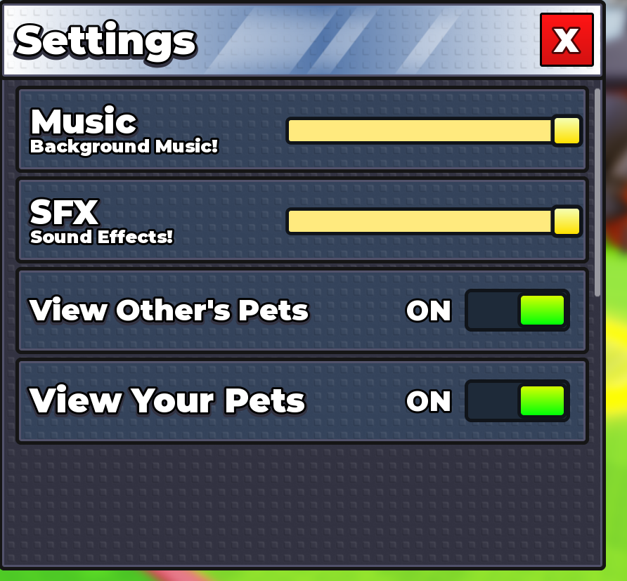

# Referências visuais

Imagens fornecidas pelo desenvolvedor, copiadas sem alteração para este cofre para não depender de Temp ou do chat. **Referências, não screenshots de aprovação do nosso jogo.** Não atribuir a nós a autoria dos jogos/arte mostrados.

## Lumito antes do redesign

Este é o estado a melhorar, não o alvo de qualidade. A direção exata de volumes e material está em revisão após o feedback de 20/10/2026. Ver [[06_Referencias/Estudo visual Steal an Egg]] e [[01_Produto/Design UI UX]] antes de encomendar um novo modelo.

## Botões e recursos

Direção solicitada com fidelidade: volume glossy, ícones próprios, contorno, branco legível e números fortes. Ajustar proporção ao HUD; não importar botões que ainda não possuem função.

## Index

Aproveitar grade, silhueta, contraste de raridade e ficha selecionada. Nosso Index não possui Claim/recompensas; não copiar esses controles. Steal a Brainrot também inspira descoberta por variante; não depende de replicar seu catálogo.

## Shop

Aproveitar imagens dominantes, preços legíveis e hierarquia. Nosso Shop vende ferramentas/laços; não importar ovos, produtos Robux, probabilidades de compra ou urgência artificial.

## Settings

Aproveitar linhas claras, controles grandes, textura e X evidente. Hoje temos Sound e Base creatures; controles separados de música/SFX e visibilidade própria/alheia seriam novo escopo.

Regras completas: [[01_Produto/Design UI UX]]. Relação com inspirações: [[01_Produto/Visao e Escopo]]. Pesquisas antigas de regras/preços externos foram retiradas do conjunto vigente; verificar fontes atuais se voltarem a ser necessárias.
